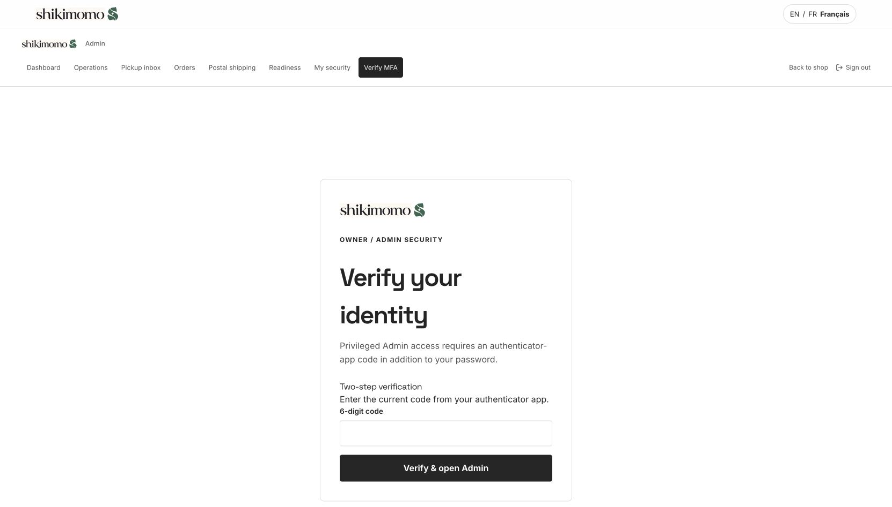
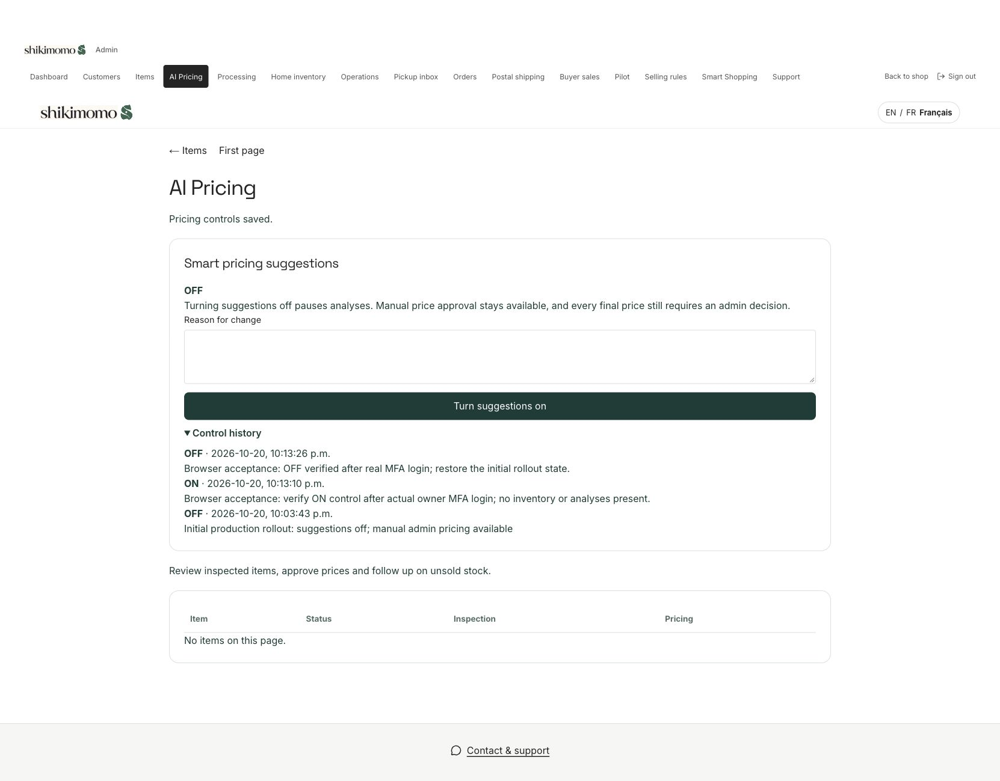

# Admin pricing rollout — 20 October 2026 (Toronto)

The owner explicitly requested production installation and an on/off control in the admin panel. This supersedes the earlier draft-only publication scope. Initial smart suggestions are **OFF**. Manual pricing and final admin approval remain available regardless of this switch.

## Observed release result

- PR #62 merged as `54b3d89cd09b530ce34c2865d58f5992a50cb0a1`.
- Vercel production deployment `dpl_24cBegQxZRKMXVq3nDQtyBBD7ZBY` is **READY**, builds that exact commit, and has `shikimomo.com` and `www.shikimomo.com` assigned with no alias error.
- All three reviewed migrations applied successfully to the production project. Migration count increased from 117 to 120. Items/orders/Bags remained 0/0/0; no synthetic rows were inserted into production. The selling-rule value fingerprint remained `c9df91412d10fcb582ee91020b2d001a`.
- Production suggestions are **OFF**, with zero analyses and zero approvals. Anonymous and service roles lack permission to call the toggle. No production setting was enabled by a forged/simulated JWT.
- Anonymous HTTP `/shop` returned 200. `/admin/pricing` and `/admin/mfa` redirected to `/secure-admin-login`.
- In the connected browser, the existing signed-in account requesting `/admin/pricing` reached the real `/admin/mfa` six-digit authenticator challenge. The user completed verification themselves. The dashboard then displayed **MFA verified · owner** and the actual AI Pricing page loaded successfully.
- Authenticated browser acceptance completed: the owner session submitted an explicit reason, switched **OFF → ON**, received the success confirmation, then submitted another reason and switched **ON → OFF**. The page showed OFF and both reasons in control history. A read-only database check confirmed control versions 1/2/3, exactly two `pricing.feature_changed` audit entries, final enabled=false, and unchanged zero items/orders/analyses. No test JWT was used for these production actions.
- Post-migration security advisors reported no ERROR-level findings. Five new private pricing tables have deny-by-default RLS and intentionally no direct policies; existing extension/password-protection warnings and executable guarded RPC notices remain. The advisor report is not evidence of real Auth/browser acceptance.

## Runtime control

- `/admin/pricing` shows status, a reasoned on/off action and versioned control history. The dashboard and inventory navigation link to it.
- Only an owner/admin with verified MFA may change the flag. Inventory staff with MFA may read status. Sellers, other customers, anonymous requests and service workers cannot toggle it.
- The server checks the flag before analysis requests, job claims, completions and analysis-based approvals. Disabling invalidates active leases; completed evidence and all price decisions remain intact. Queued work resumes when enabled. Advisory locks serialize a toggle against concurrent analysis operations.
- Manual approval remains available while OFF. Item inspection, seller mandate, exact-price approval, publication guards, CAD 8 floor, CAD 60 Bag minimum and locked commissions remain enforced.
- Requesting an analysis invokes the existing server-only rules worker when matching service credentials are configured. Without worker credentials, the UI explains the missing configuration; manual pricing works.
- This is a deterministic, evidence-based suggestion engine. Image recognition and automated external market APIs remain unconnected. No paid AI API is called.

## Verification before release

- 20 pricing tests passed, including three new database tests for the switch, permissions, stale control versions, lease invalidation, resume, immutable completed evidence and manual approval while OFF.
- The real production-catalog SQL flow passed again, including default-OFF manual approval/publication, explicit enabling, checkout, payment compatibility and refund.
- The new switch migration was applied to the isolated Neon pricing QA branch. Hosted PostgreSQL confirmed OFF → ON → OFF, versioned reasons/history, and rejection of AAL1 and seller toggle attempts. These JWT claims were simulated; this does not prove actual Auth/MFA.
- Next.js build/TypeScript and ESLint passed. The full repository suite reported 173 tests: 166 passed and the same seven pre-existing UI assertion/mock failures remained. They were not skipped, rewritten or reported as passing.
- The original 95 SQL files and the two previously reviewed pricing SQL files were not edited. The switch is a new forward-only migration.

## Deployment sequence

1. Verify the production project `lsdhobwrnmlkqnvkamlt`, expected main/head commits, migration presence, payment-function fingerprint and item/order counts.
2. Apply only the three reviewed pricing migrations, in order: foundation, generated-earnings payment compatibility, admin switch. Preserve existing data and business settings. Verify the new flag is OFF and privileged RPC grants are restricted.
3. Merge the reviewed pricing branch and verify Vercel project `lresale` builds that exact main commit for production; verify the custom domain serves it.
4. Check public storefront health and redirect anonymous admin/pricing requests to secure login. Complete authenticated UI/on-off acceptance only through an actual admin login/MFA session. Never forge a production JWT or weaken the MFA guards.

Real admin MFA access and browser ON/OFF acceptance have passed. Per-item browser approval/publication has not been exercised because production has no inventory. Payment-provider sandbox and bank payout remain outstanding. The SQL fixture flow must not be reported as a real gateway or bank transaction.

## Recovery

Use the admin switch to stop analysis requests and workers without changing any prices or paid-order snapshots. Keep the matching manual-pricing UI deployed. A rollback to the old UI alone would be incompatible with the new final-approval boundary, so do not blindly roll back the application to the pre-pricing version. Diagnose deployment failures before changing live domains; retain migration/approval history.

No new credentials, paid AI provider, production MFA enrollment or customer messages are introduced by this rollout.
